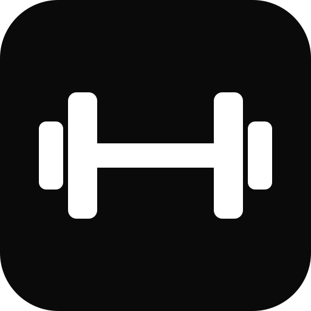

<p align="center">
  
</p>

<h1 align="center">Mega Lift</h1>

<p align="center">
  <b>Sua ficha de treino, do jeito que você monta.</b><br>
  Escolha os exercícios, defina séries, repetições e carga, siga o guia de execução<br>
  e acompanhe sua evolução, metas e nível.
</p>

<p align="center">
  <a href="https://github.com/Studio-of-the-Depths/mega-lift-download/releases/latest"></a>
  <a href="https://github.com/Studio-of-the-Depths/mega-lift-download/releases"></a>
  
</p>

---

## Baixar

| Plataforma | Download | Requisitos |
| --- | --- | --- |
| **Android** | [MegaLift.apk](https://github.com/Studio-of-the-Depths/mega-lift-download/releases/latest/download/MegaLift.apk) | Android 7.0 ou superior |
| **Navegador** | [Abrir o Mega Lift](https://mega-lift-web.vercel.app) | Qualquer navegador moderno |

> As notas de cada versão e os checksums (`SHA256SUMS.txt`) estão em [Releases](https://github.com/Studio-of-the-Depths/mega-lift-download/releases).

### Como instalar

**Android**
1. Baixe o `MegaLift.apk` pelo navegador do celular.
2. Quando o Android pedir, permita **instalar apps desconhecidos** para esse navegador.
3. Abra o arquivo baixado e toque em **Instalar**. Se o Play Protect avisar que o app não é conhecido, escolha **Instalar assim mesmo**: o Mega Lift ainda não está na Play Store.

O app abre o Mega Lift em tela cheia e se atualiza sozinho: novidades do site aparecem sem baixar outro APK. Na primeira abertura é preciso internet; depois, seu plano e histórico continuam disponíveis sem sinal.

### Conferir a autenticidade do APK

O APK é assinado com a chave do Mega Lift. Para conferir, rode no PC com o Android SDK:

```bash
apksigner verify --print-certs MegaLift.apk
```

O certificado tem que ser este:

```
SHA-256: 51:D9:0A:F0:60:9F:A6:79:9F:B6:EB:E6:30:E2:E6:4F:98:9E:D1:ED:9C:E4:D0:95:26:85:D0:CF:C4:65:50:27
```

Se for diferente, não instale.

---

## O que é

O Mega Lift é uma ficha de treino digital: **você monta o seu treino**, sem timers nem notificações te cobrando.

- **Monte seus treinos** com exercícios do catálogo (ou crie os seus), séries, repetições e carga
- **Guia de exercícios** em português, com foto, músculos trabalhados, passo a passo e erros comuns
- **Hoje**: o treino do dia, sua sequência de dias e estatísticas da semana
- **Evolução**: gráficos de carga por exercício e de peso corporal
- **Metas** de peso e frequência semanal
- **Nível**: ganhe XP treinando e suba de Plâncton a Megalodon
- **Funciona offline** e sincroniza entre aparelhos com a sua conta
- **Tema claro e escuro**

## Problemas e sugestões

Achou um erro ou tem uma ideia? Abra uma [issue](https://github.com/Studio-of-the-Depths/mega-lift-download/issues/new) dizendo o aparelho, a versão e o que aconteceu.

## Licença

Mega Lift © 2026 Studio of the Depths. O aplicativo é distribuído gratuitamente, sem garantias. O código-fonte é privado.

<p align="center"><sub>Feito por <b>Studio of the Depths</b></sub></p>
